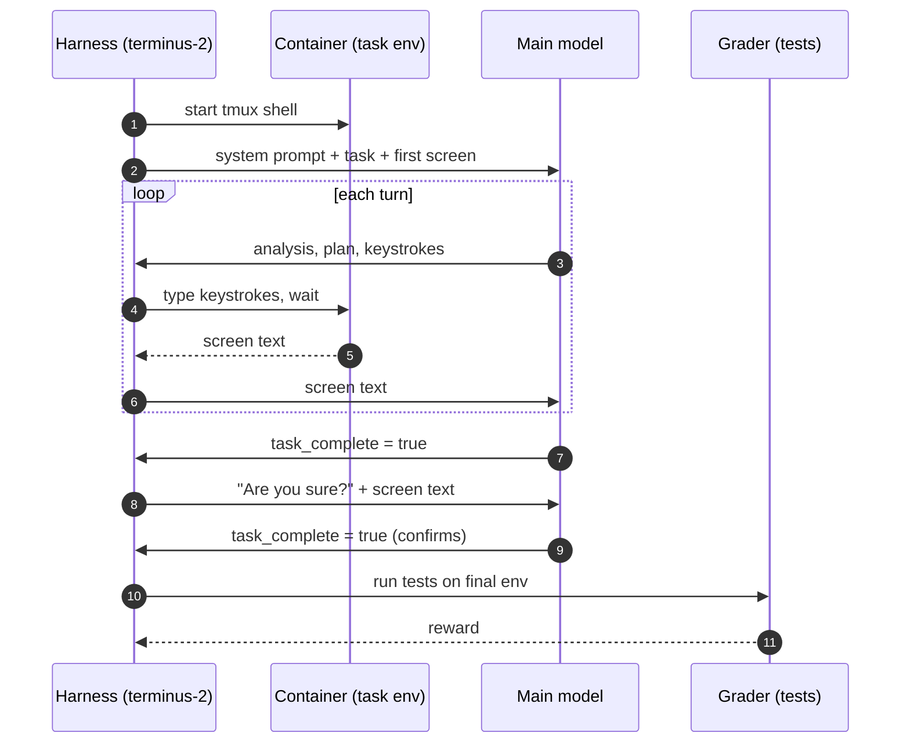

# H0: stock terminus-2 (the baseline)

The unmodified harness that every variant is compared against. Each turn, the model replies with
its analysis, a plan and keystrokes plus a `duration`. The harness types the keystrokes into a tmux
shell, sleeps for that duration (at most 60 s) and sends back the screen text. The history keeps
every reply and every screen, with the model's reasoning dropped. When the model sets
`task_complete`, the harness asks "Are you sure?" once. A second `task_complete` ends the trial, and
the tests then grade the final machine. The agent time limit is 2400 s; the tests also run when it
expires.

