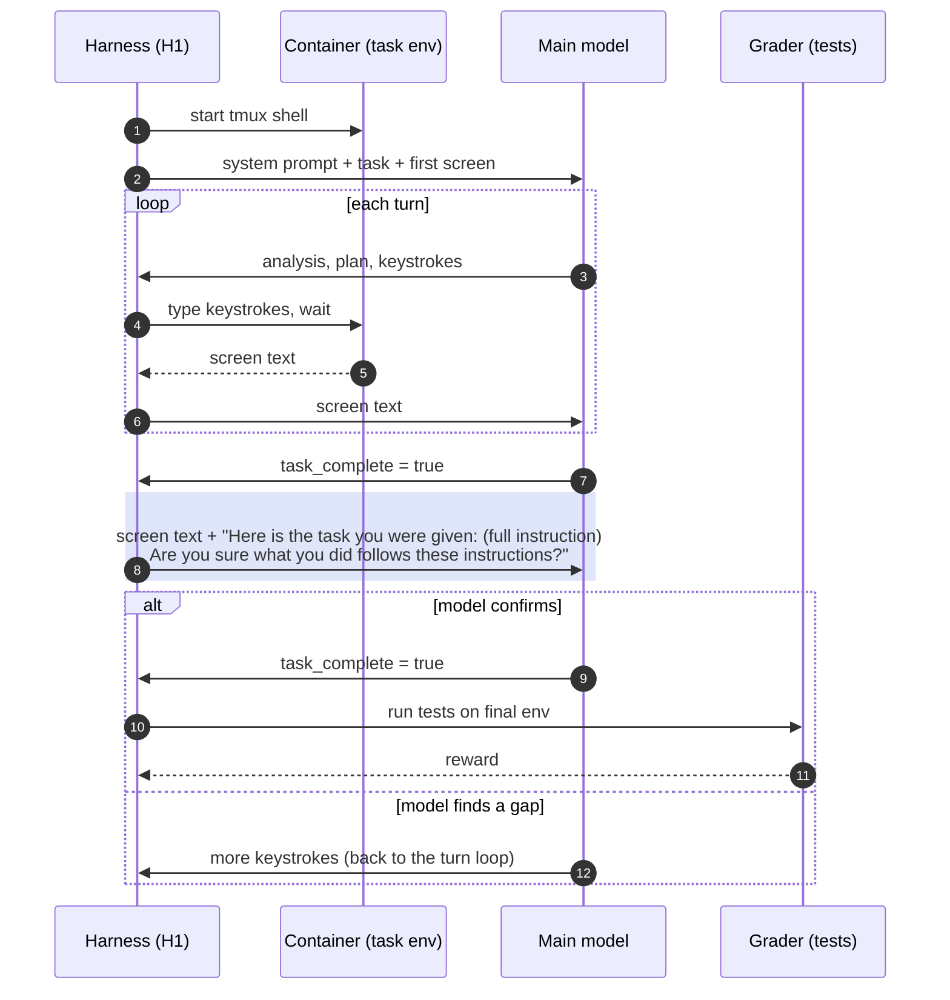

# H1: the completion check restates the instruction (`terminus_2_harness1.py`)

Only the "Are you sure?" step changes (shaded). Before it confirms, the model sees the original
task again, so it compares its work with what was asked rather than with what it remembers.

