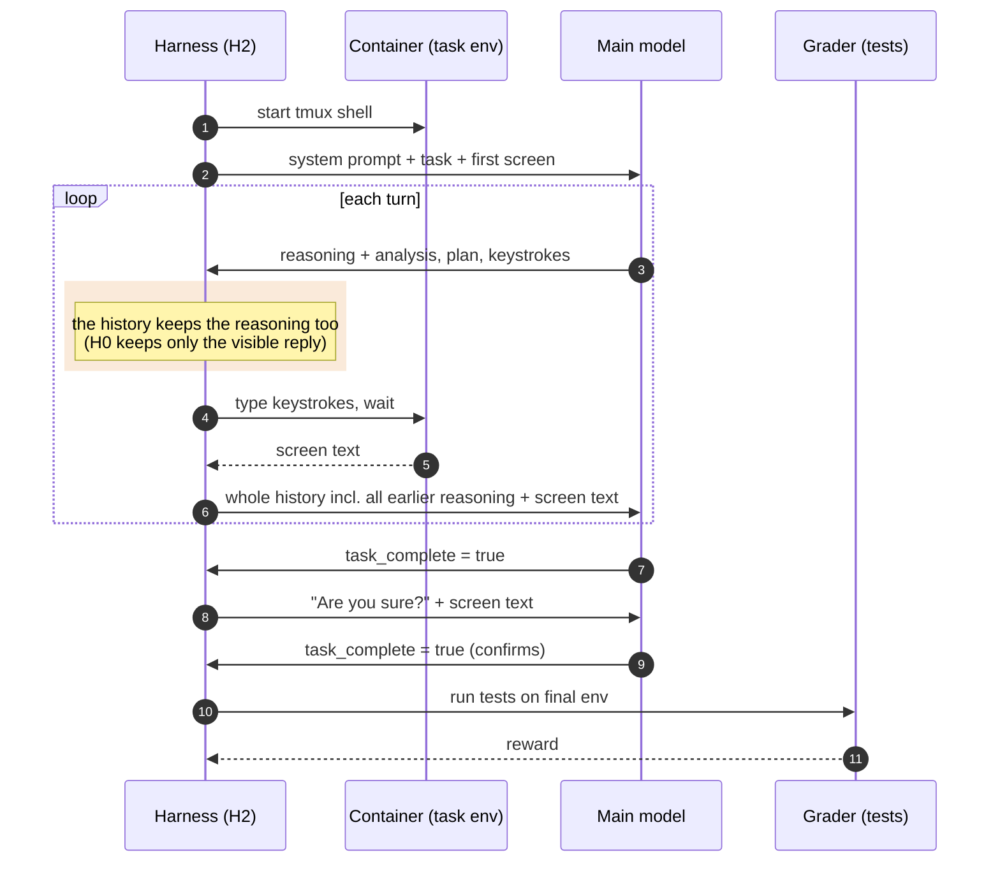

# H2: reasoning kept in the history (`interleaved_thinking: true`)

Stock terminus-2 sends back only the model's visible replies from earlier turns and drops their
reasoning. H2 keeps each turn's reasoning in the chat history (shaded), so the model can see why it
did what it did. On Qwen3.6 this also needs `chat_template_kwargs.preserve_thinking: true`;
without it the chat template strips the reasoning anyway. The cost is a much longer prompt on
every turn.

