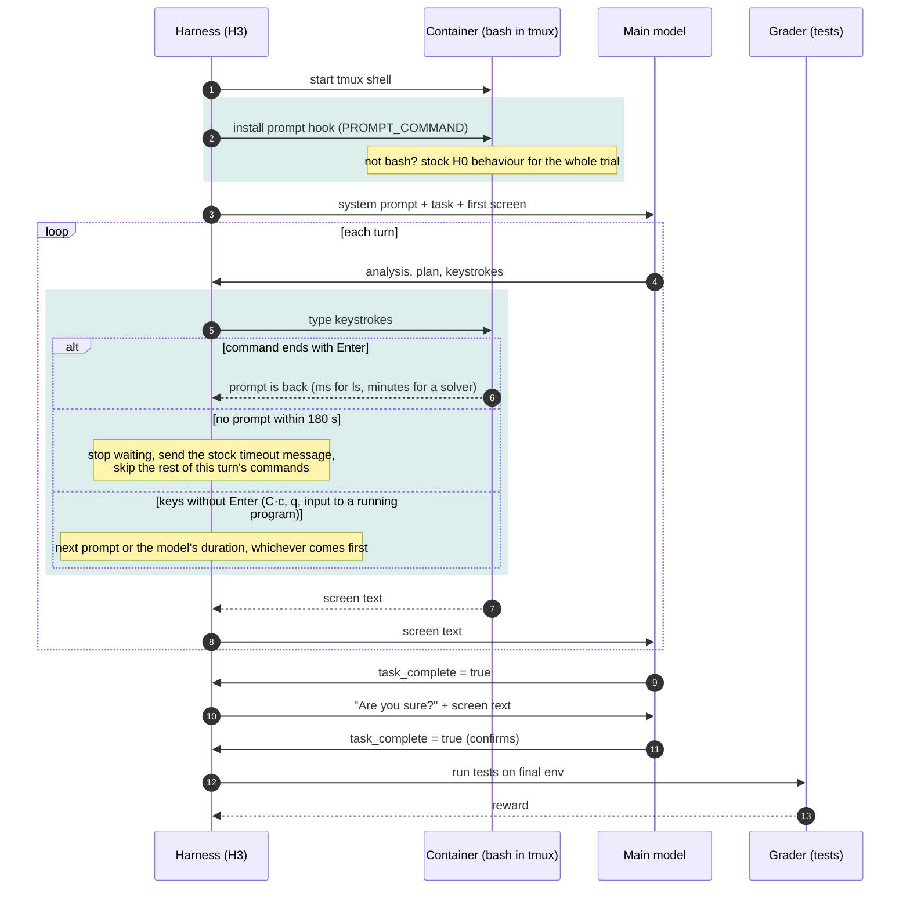

# H3 "Listen": wait for bash's completion signal (`terminus_2_harness3.py`)

H0 types a command, sleeps for the `duration` the model guessed (at most 60 s), then reads the
screen whether or not the command has finished. H3 installs a bash prompt hook (PROMPT_COMMAND).
Bash runs it each time a command finishes and the prompt returns, and the harness reads the
screen as soon as that happens (shaded). The wait is capped by `max_wait_sec` = 180 s.

Known bug: one exec both sends the keystrokes and waits, so its command line contains the
keystrokes. An agent's `pkill -f <pattern>` can match it and kill the harness's own wait.
The fix is pending.

