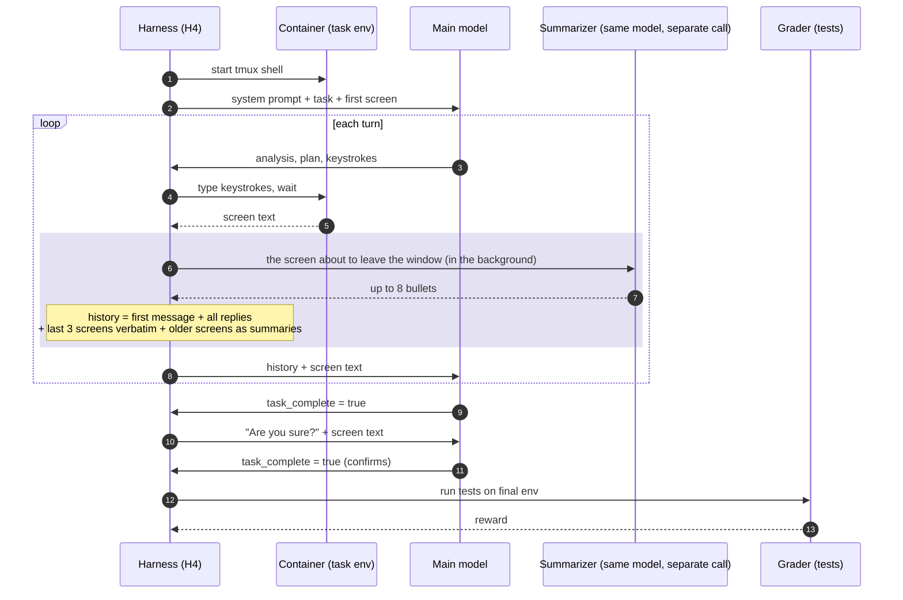

# H4: rolling observation window (`terminus_2_harness4.py`)

The prompt keeps only the last 3 terminal outputs word for word. Each older output is replaced by
a short bullet summary written by a separate call to the same model (shaded). The first message
(system prompt, task and first screen) and every model reply stay untouched. Each summary starts
in the background one turn early (prefetch), so the main loop rarely waits. The qwen38 run used
`summary_reasoning_effort: none`.

