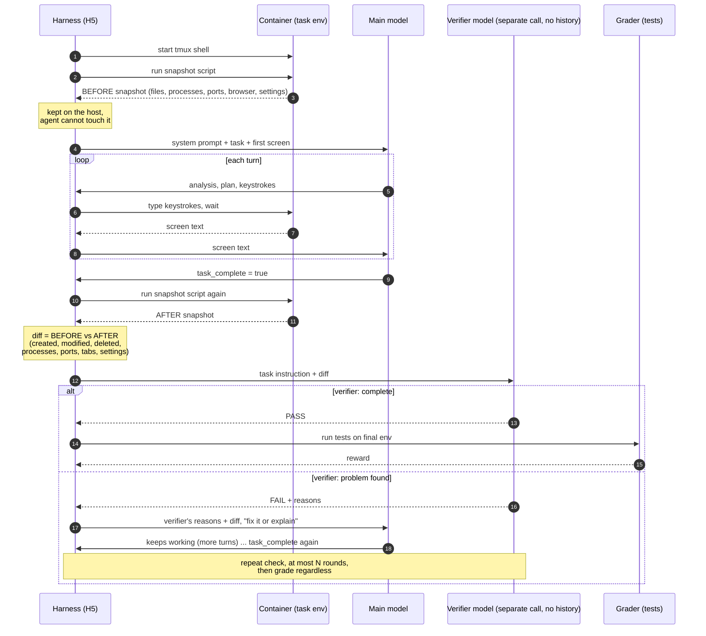

# H5 "Snapshot verifier": before/after snapshot + independent verifier (`terminus_2_harness5.py` + `h5_snapshot.py`)

Before the agent starts, a snapshot script records the machine's state: files (with the content of
small text files and the structure of office files), processes, listening ports, browser tabs,
desktop windows and settings, and Python packages. The snapshot is kept on the host, where the
agent cannot change it. When the agent says it is done, the harness takes a second snapshot. A
verifier then judges the task text plus the diff: a separate call to the same model, with no chat
history. PASS sends the trial to grading. FAIL sends the verifier's reasons and the diff back to
the agent, which keeps working. After at most 2 checks the trial is graded regardless. Verifier
tokens are counted in the trial's cost. Logs: `agent/env-before.json`, `env-after-N.json`,
`verifier-checks.json`.

