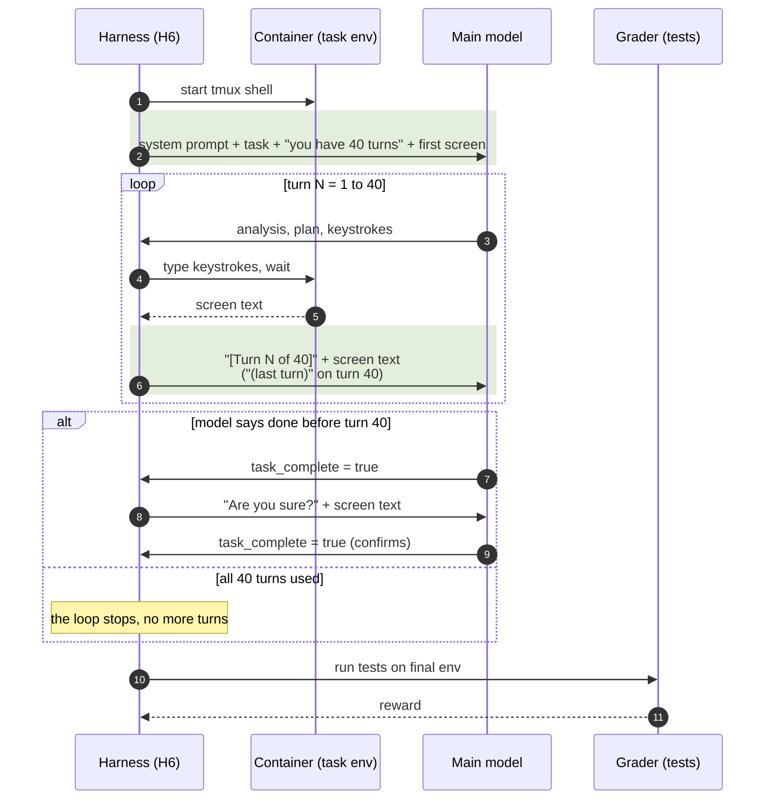

# H6 "Turn budget": 40 turns, with a counter on every turn (`terminus_2_harness6.py`)

The task text tells the model it has 40 turns, and every screen update starts with
"[Turn N of 40]" (shaded). The model can plan and wrap up in time rather than hitting the time
limit without warning. After turn 40 the loop stops and the environment is graded as it stands.

