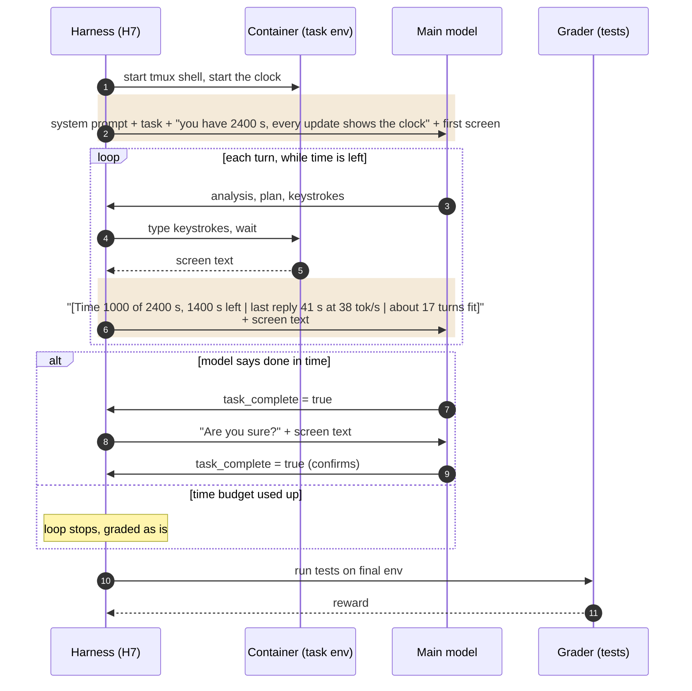

# H7 "Time budget": a clock on every turn (`terminus_2_harness7.py`)

The model is told its time budget at the start (default 2400 s). Every screen update begins with a
clock: time used and time left, how long its last reply took and at what speed (output tokens per
second), and how many more turns fit at its recent pace (shaded). Nothing else changes. When the
budget is used up the loop stops and the machine is graded as it stands. Kwarg: `time_budget_sec`;
the budget is part of the config name (`harness7-time2400-attempt5`).

