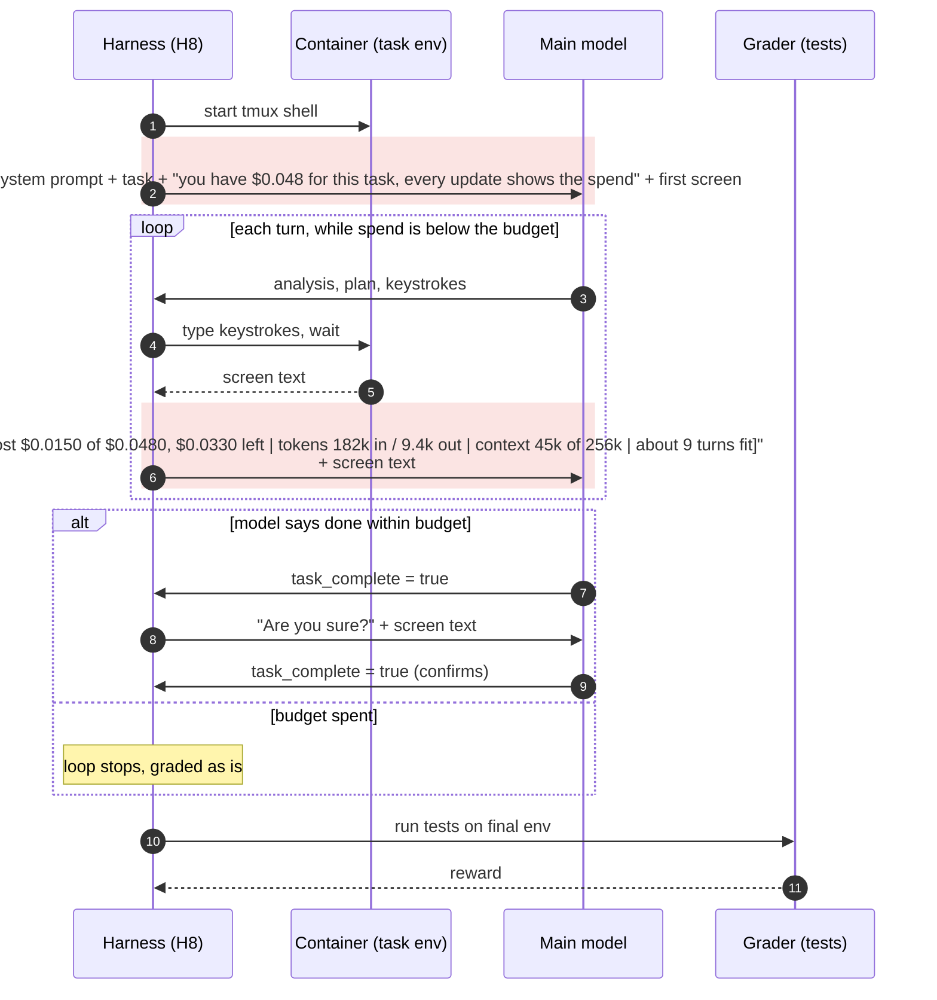

# H8 "Cost budget": a spend meter on every turn (`terminus_2_harness8.py`)

The model is told its dollar budget for the task at the start. Every screen update begins with a
spend meter: dollars used and left, tokens used (input / output), how full the context is, and how
many more turns fit at the cost of its recent turns (shaded). Cost is harbor's own per-trial cost,
so helper calls count too. When the budget is spent the loop stops and the machine is graded as it
stands. Starting budget: qwen3.8 $0.048, Qwen3.6 $0.26, the 90th-percentile cost of H0's solved
trials. Kwarg: `cost_budget_usd`; the budget is part of the config name (`harness8-cost0.048-attempt5`).

