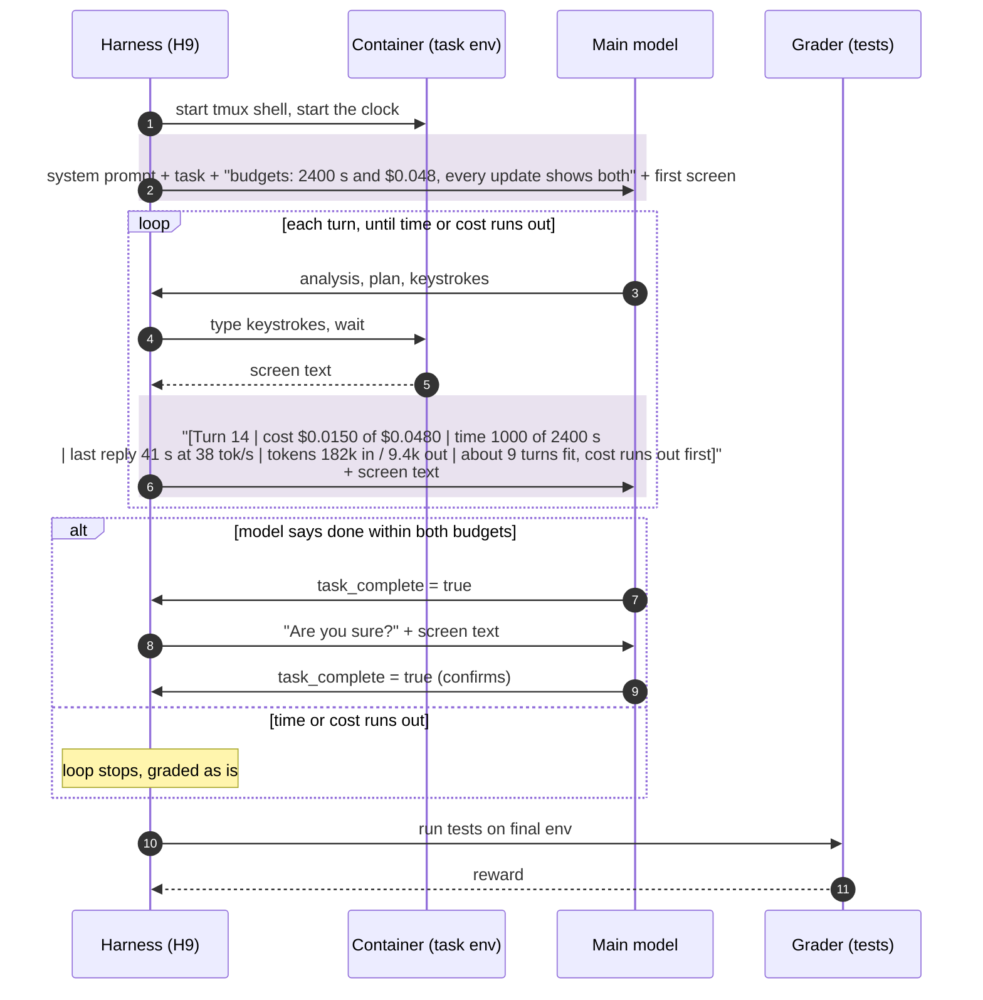

# H9 "All budget": time and cost together, plus the turn count (`terminus_2_harness9.py`)

H7 and H8 combined. The model is told both budgets at the start. Every screen update shows the turn
number, dollars used of the budget, time used of the budget, last reply speed, tokens used, and how
many turns fit before the tightest budget runs out, and which budget that is (shaded). Turns are
shown, not capped. The loop stops when either time or cost runs out, and the machine is graded as it
stands. Kwargs: `time_budget_sec`, `cost_budget_usd`; both budgets are part of the config name
(`harness9-time2400-cost0.048-attempt5`).

