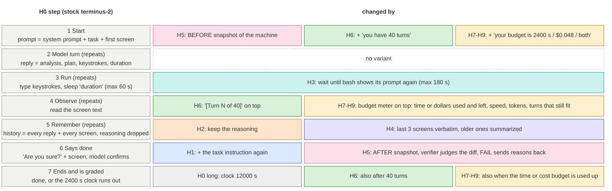

# Harness variants: which step of the H0 loop each one changes

Read it as a table. Left: the stock terminus-2 (H0) steps, top to bottom; steps 2 to 5 repeat every
turn. Right: the variants that change that step. Colours match the results plot. H7–H9 share one
meter and differ only in which budgets they show and enforce (H7 time, H8 cost, H9 both plus the
turn number). Each variant has its own file (`H1.md` ... `H9.md`, `H0-timeout12000.md`).

