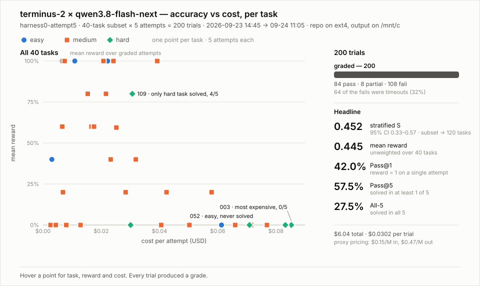

# harness0-attempt5 — results

**This is the H0 base benchmark.** All later variants are compared against this run.

Run `/mnt/c/Users/<win-user>/Desktop/playground/TUA-Bench/jobs/harness0-attempt5/2026-09-23__14-45-40/` · 40-task subset × 5 attempts = 200 trials · stock terminus-2 (harbor v0.6.3) × qwen3.8-flash-next · 2026-09-23 14:45 → 09-24 11:05 (20 h 20 m) · repo on WSL ext4, job output on /mnt/c

> **Clean run: all 200 trials graded.** No UID failures and no infrastructure failures.
>
> **Caveat — one grader could not run.** `009-repair-org-chart-layout` is judged by an LLM (Gemini). No
> `GEMINI_API_KEY` / `GOOGLE_API_KEY` was set, so its grader raised `RuntimeError: Missing Gemini API key`
> and all 5 attempts scored 0 **without being judged**. Every other zero is a genuine verdict. Effect on the
> headline: reported S = 0.452; excluding `009`, S = 0.463; had `009` been solved 5/5, S = 0.479. Re-run
> `009` with a Gemini key before quoting a final number.



## Headline

| metric | value | note |
|---|---|---|
| **stratified S** (`subset/score.py`) | **0.452** | estimate for the full 120-task benchmark · 95% bootstrap CI **0.333–0.575** |
| mean reward | 0.445 | unweighted over the 40 subset tasks (harbor `mean`) |
| Pass@1 | 42.0% | reward exactly 1 on a single attempt |
| Pass@2 / Pass@4 | 49.2% / 55.5% | |
| Pass@5 | 57.5% | solved in at least 1 of 5 |
| All-5 | 27.5% | solved in all 5 |
| timeouts | 64 / 200 (32%) | the paper reports 4 / 600 at the same 2400 s |
| cost | $6.04 | $0.0302/trial · proxy pricing $0.15/M in, $0.47/M out (no OpenRouter listing for flash-next) |

harbor's own `pass_at_k` is empty: it refuses when any reward isn't exactly 0 or 1. Pass@k above comes from `subset/tools/leaderboard_metrics.py` and counts only reward = 1 as a pass.

**Trial outcomes:** fail 108 · pass 84 · partial 8

## Per task

`graded` = attempts that produced a reward. `reward` = mean over graded attempts.

| task | diff | image | graded | pass | reward | $/attempt | outcomes |
|---|---|---|---|---|---|---|---|
| `029-natural-products-page` | easy | `debian:bookworm` | 5/5 | 5 | 1.00 | 0.0112 | pass 5 |
| `034-turn-off-dark-mode` | easy | `debian:bookworm` | 5/5 | 5 | 1.00 | 0.0394 | pass 5 |
| `044-etsy-saved-passwords` | easy | `debian:bookworm` | 5/5 | 5 | 1.00 | 0.0237 | pass 5 |
| `045-united-bag-fee-page` | easy | `debian:bookworm` | 5/5 | 5 | 1.00 | 0.0222 | pass 5 |
| `046-restore-tripadvisor-tab` | easy | `debian:bookworm` | 5/5 | 5 | 1.00 | 0.0064 | pass 5 |
| `048-tamiflu-side-effects` | easy | `debian:bookworm` | 5/5 | 5 | 1.00 | 0.0109 | pass 5 |
| `052-vignette-filter-window` | easy | `ubuntu:24.04` | 5/5 | 0 | 0.00 | 0.0613 | fail 5 |
| `115-remove-explorer-find-key` | easy | `debian:bookworm` | 5/5 | 2 | 0.40 | 0.0030 | fail 3 pass 2 |
| `009-repair-org-chart-layout` | medium | `ubuntu:24.04` | 5/5 | 0 | 0.00 | 0.0406 | fail 5 |
| `012-hide-na-budget-values` | medium | `ubuntu:24.04` | 5/5 | 1 | 0.20 | 0.0069 | fail 4 pass 1 |
| `016-count-invoice-pivot` | medium | `ubuntu:24.04` | 5/5 | 1 | 0.20 | 0.0284 | fail 4 pass 1 |
| `018-calculate-total-earnings` | medium | `ubuntu:24.04` | 5/5 | 5 | 1.00 | 0.0067 | pass 5 |
| `020-calculate-period-rate` | medium | `ubuntu:24.04` | 5/5 | 0 | 0.00 | 0.0041 | fail 5 |
| `021-fill-ramp-chart` | medium | `ubuntu:24.04` | 5/5 | 3 | 0.60 | 0.0066 | fail 2 pass 3 |
| `025-product-channel-pivots` | medium | `ubuntu:24.04` | 5/5 | 1 | 0.20 | 0.0424 | fail 4 pass 1 |
| `030-womens-nike-jerseys` | medium | `debian:bookworm` | 5/5 | 2 | 0.40 | 0.0319 | fail 3 pass 2 |
| `038-zurich-rental-car` | medium | `debian:bookworm` | 5/5 | 5 | 1.00 | 0.0242 | pass 5 |
| `039-manchester-forecast` | medium | `debian:bookworm` | 5/5 | 5 | 1.00 | 0.0392 | pass 5 |
| `042-black-sale-coffee-makers` | medium | `debian:bookworm` | 5/5 | 4 | 0.80 | 0.0154 | fail 1 pass 4 |
| `043-load-hello-extension` | medium | `debian:bookworm` | 5/5 | 5 | 1.00 | 0.0208 | pass 5 |
| `050-mri-png-slices` | medium | `ubuntu:24.04` | 5/5 | 4 | 0.80 | 0.0216 | fail 1 pass 4 |
| `054-prostate-label-obj` | medium | `ubuntu:24.04` | 5/5 | 0 | 0.40 | 0.0232 | fail 1 partial 4 |
| `059-make-summary-slide` | medium | `ubuntu:24.04` | 5/5 | 0 | 0.00 | 0.0660 | fail 5 |
| `061-insert-features-table` | medium | `ubuntu:24.04` | 5/5 | 0 | 0.00 | 0.0026 | fail 5 |
| `067-align-slide-textboxes` | medium | `ubuntu:24.04` | 5/5 | 0 | 0.00 | 0.0080 | fail 5 |
| `069-linux-ls-tutorial` | medium | `debian:bookworm` | 5/5 | 3 | 0.60 | 0.0166 | fail 2 pass 3 |
| `071-paste-image-docx` | medium | `debian:bookworm` | 5/5 | 0 | 0.00 | 0.0044 | fail 5 |
| `088-extract-presenter-photos` | medium | `debian:bookworm` | 5/5 | 0 | 0.00 | 0.0503 | fail 5 |
| `089-install-recommended-exts` | medium | `debian:bookworm` | 5/5 | 1 | 0.20 | 0.0579 | fail 4 pass 1 |
| `094-author-homepage-bookmarks` | medium | `debian:bookworm` | 5/5 | 0 | 0.00 | 0.0769 | fail 5 |
| `095-save-apple-searching-page` | medium | `debian:bookworm` | 5/5 | 0 | 0.59 | 0.0252 | fail 1 partial 4 |
| `096-first-author-table` | medium | `debian:bookworm` | 5/5 | 0 | 0.00 | 0.0129 | fail 5 |
| `099-professor-contact-info` | medium | `debian:bookworm` | 5/5 | 3 | 0.60 | 0.0175 | fail 2 pass 3 |
| `100-name-mountain-photos` | medium | `debian:bookworm` | 5/5 | 0 | 0.00 | 0.0715 | fail 5 |
| `119-tabstop-sentence-split` | medium | `ubuntu:24.04` | 5/5 | 5 | 1.00 | 0.0074 | pass 5 |
| `003-rebuild-energy-model` | hard | `ubuntu:24.04` | 5/5 | 0 | 0.00 | 0.0853 | fail 5 |
| `005-optimize-cold-plate` | hard | `openfoam/openfoam11-paraview510` | 5/5 | 0 | 0.00 | 0.0301 | fail 5 |
| `007-reconstruct-prostate-obj` | hard | `ubuntu:24.04` | 5/5 | 0 | 0.00 | 0.0709 | fail 5 |
| `033-prostate-volume-est` | hard | `ubuntu:24.04` | 5/5 | 0 | 0.00 | 0.0833 | fail 5 |
| `109-setup-outlook-account` | hard | `ubuntu:24.04` | 5/5 | 4 | 0.80 | 0.0307 | fail 1 pass 4 |

## Reproduce

```bash
R=/mnt/c/Users/<win-user>/Desktop/playground/TUA-Bench/jobs/harness0-attempt5/2026-09-23__14-45-40/
python3 subset/tools/task_report.py $R --json /tmp/r.json
python3 subset/score.py $R
python3 subset/tools/leaderboard_metrics.py $R
# add harbor_mean, score_py (and for a clean run ci_lo, ci_hi, pass1/2/4/5, all5, timeouts) to /tmp/r.json
python3 subset/tools/plot_accuracy_cost.py /tmp/r.json subset/results/<name>-accuracy-cost.svg "subtitle"
python3 subset/tools/results_md.py /tmp/r.json subset/results/<name>.md $R "header" <name>-accuracy-cost.svg
```
